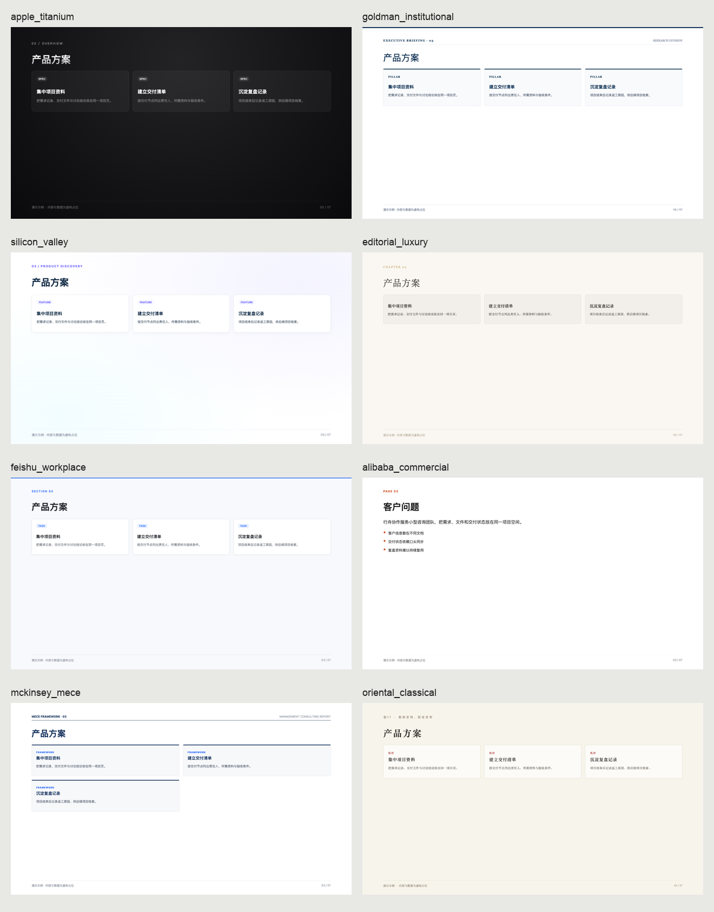

# PrettyPPT

把资料交给 Agent，说清用途，生成可编辑的 PPTX 与 HTML 演示文稿。

默认 **自动选模板、适度参考、按内容决定页数**。用户可以说“严格照这套模板”或“更自由一点”，切换到保守或自由档。十个场景各有八款具备不同构图、叙事顺序和页面组合的模板，共 80 套核心参考。

**v0.2.0 格式说明：HTML 提供完整视觉效果；PPTX 提供基础可编辑排版，两者外观不完全一致。** HTML 中的渐变、光效、印章及部分布局尚未移植到原生 PPTX。需要保留完整视觉时，使用 HTML 演示或浏览器导出 PDF；需要继续编辑文字、图表和表格时，使用 PPTX。

[下载 v0.2.0](https://github.com/TeacherXuAI/prettyppt/releases/tag/v0.2.0) · [下载离线视觉画廊](https://github.com/TeacherXuAI/prettyppt/releases/download/v0.2.0/prettyppt-v0.2.0-gallery.html) · [下载模板包](https://github.com/TeacherXuAI/prettyppt/releases/download/v0.2.0/prettyppt-v0.2.0-templates.zip)

## 给 Agent 使用

将本项目放入 Agent 可读取的工作目录，让它阅读 [SKILL.md](SKILL.md)：

> 使用 PrettyPPT。附件是我们的产品资料，做一份给潜在客户看的产品介绍 PPT。

Agent 负责理解资料、组织内容、选择模板和检查页面；本工具包负责可复现的分页与 HTML/PPTX 渲染。无需为 PrettyPPT 配置新的模型 API。Agent 需要能读取文件、运行 Python 并交付生成的文件。仅粘贴提示词到没有文件或代码执行能力的聊天窗口，不会自动产生文件。

原有 [AGENT_SKILL.md](AGENT_SKILL.md) 保留为兼容入口，与 SKILL.md 同步。

## 安装与直接使用

Python 3.8+：

```bash
pip install git+https://github.com/TeacherXuAI/prettyppt.git
prettyppt generate -i materials.md --purpose "给新同事做项目培训" -o output/training
```

默认输出 `.pptx`、`.html` 和可继续编辑的 `.deck.json`。不指定场景、风格和页数时会自动选择。直接导入原文会保留文字并分页；需要内容概括、叙事编排和图表提炼时，使用上面的 Agent 工作流。

支持 TXT、Markdown、CSV、DOCX、PPTX 文字和文本型 PDF。PDF 提取另装 `pip install pypdf`。扫描件和复杂图表由 Agent 的视觉/OCR 能力读取。原文提取不等于已经理解图片内容。

## 三档参考强度

| 档位 | 行为 | 适合的表达 |
|---|---|---|
| conservative / 保守 | 保留模板构图、配色和字体，替换内容，按需要扩页 | “照着这套做” |
| moderate / 适度，默认 | 保留主视觉，按内容量调整布局、章节与页数 | “按我的资料调整” |
| free / 自由 | 跨模板选择版式，支持自定义布局、颜色和可编辑页面元素 | “参考审美，重新设计” |

三档都使用用户输入，不会将模板里的虚构数字自动填进真实资料。自由档的几何布局与文字容量也会检查。

## 80 款模板

十个场景：融资路演、年度汇报、产品发布、行业研究、战略规划、品牌提案、培训课件、业务评审、大会演讲、作品集。

| 核心风格 ID | 构图特点 |
|---|---|
| apple_titanium | 深色微光背景、渐变标题、半透明卡片与指标块 |
| goldman_institutional | 深蓝侧栏封面、金线与衬线标题、研报表格 |
| silicon_valley | 紫青微光、产品窗口式封面、功能与数据卡片 |
| editorial_luxury | 暖纸色、衬线排印、细线与菱形装饰 |
| feishu_workplace | 日光浅灰底、蓝色标签、任务卡片 |
| alibaba_commercial | 橙色强调、商业卡片与关键数字 |
| mckinsey_mece | 深蓝导航、框架卡片与量化表格 |
| oriental_classical | 宣纸底、宋体、朱砂印章与书卷卡片 |

名称用于描述设计参考，项目与这些公司没有官方关联。另有八款旧版配色保留在 SDK 中，不计入 80 套核心模板。

下图为八款融资路演模板的实际 HTML 内容页，完整页面在离线画廊中查看。PPTX 使用基础可编辑排版：



```bash
prettyppt preview
prettyppt templates -s annual_review
prettyppt gallery -o gallery/index.html --pptx
prettyppt generate --demo -s annual_review -t editorial_luxury -o sample
```

画廊预览直接使用 HTML 视觉渲染器生成；`gallery --pptx` 还会导出 80 套基础可编辑 PPTX。所有模板样例都明确标注虚构示例。HTML 和画廊不依赖远程脚本，可离线查看。

## Agent 的资料接口

```bash
prettyppt prepare -i product.docx feedback.pdf --purpose "客户产品介绍" -o materials.json
# Agent 阅读资料，写出 brief.json
prettyppt generate -i brief.json --mode moderate -o output/product
```

[brief 规范与自由布局说明](references/brief.md) · [完整产品示例](examples/product-brief.json) · [原文输入示例](examples/materials.md) · [自由构图示例](examples/free-layout.json)

每节可包含正文、要点、并列内容、指标、原生表格、原生图表、图片和出处。长内容按容量拆页，不使用省略号截断。超长标题、过密单元格或无法容纳的自定义构图会明确报错，交回 Agent 改写。

```python
import json
from prettyppt import create_presentation, generate_html_deck, generate_pptx_deck

brief = json.load(open("brief.json", encoding="utf-8"))
deck = create_presentation(brief)  # auto / moderate / 按内容分页
open("presentation.html", "w", encoding="utf-8").write(generate_html_deck(deck))
generate_pptx_deck(deck, "presentation.pptx")
```

## 修改与页数

```bash
prettyppt render -i presentation.deck.json -o revised.pptx
prettyppt generate -i brief.json --pages 10 -o presentation
```

`--pages` 是严格页数检查，包含封面。内容放不下时会要求 Agent 调整资料结构，不静默删内容或补空白页。来源进入 PPTX 备注和源文件；观众需要知道的限制应放在正文。

## 验证与开发

```bash
pip install -e .
python -m unittest discover -s tests -v
python scripts/sync_agent_docs.py
python -m prettyppt.cli gallery -o prettyppt/viewers/gallery.html
```

HTML 和 PPTX 共用资料模型与分页逻辑，采用不同的视觉渲染方式。自由档按指定的布局坐标、配色和自定义元素渲染。PPTX 的文字、表格与图表保持可编辑，但不等同于 HTML 视觉效果。中文字体在不同电脑上可能发生替换；交付前仍应查看目标软件的实际渲染。自动结构检查不能代替视觉检查。

v0.2 的 `generate` 要求输入资料；仅生成样例时显式使用 `--demo`。`get_template()` 返回带示例标识的模板参考，生产内容使用 `create_presentation()`。

[MIT License](LICENSE)
